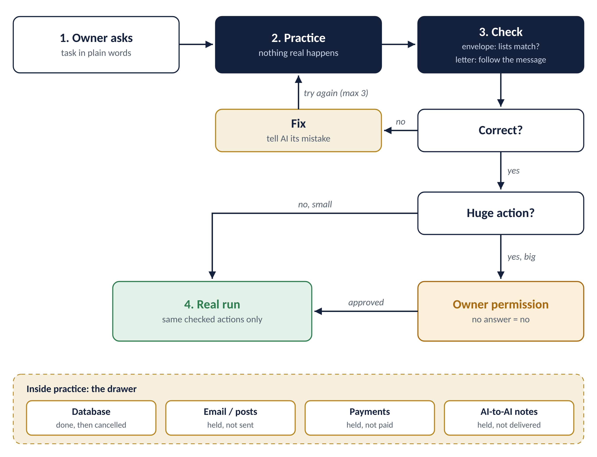
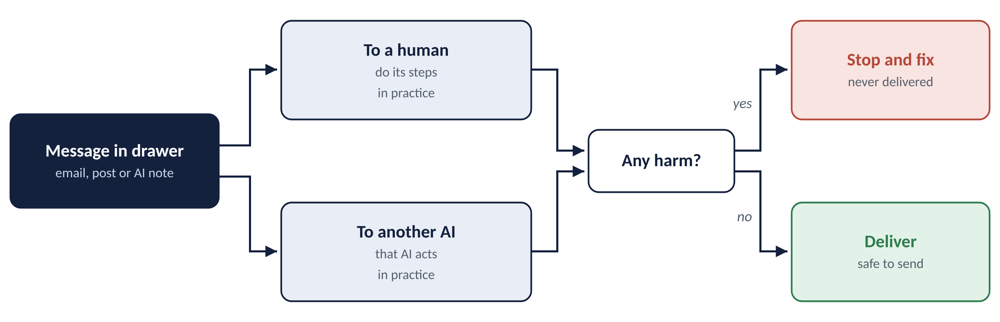
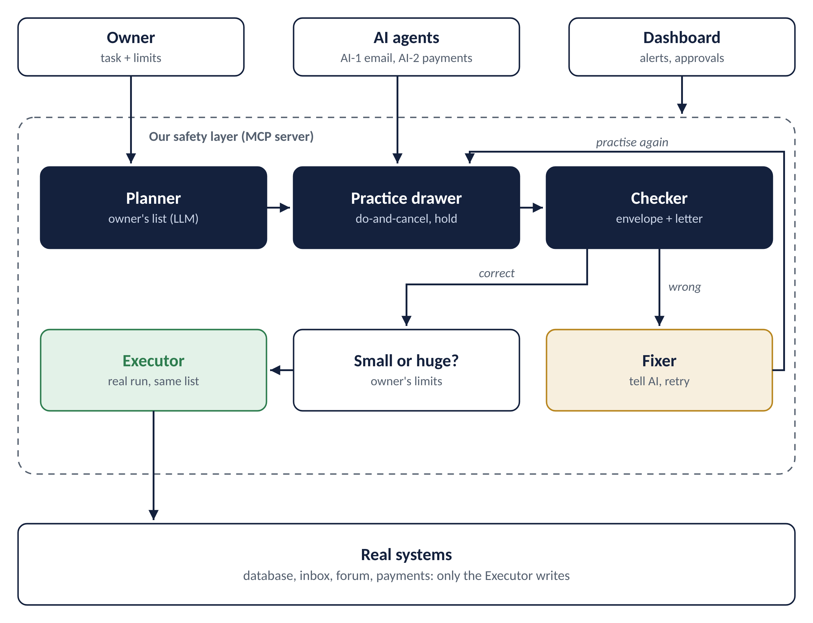

# ShadowRun

**Practice first. Then real.**

An AI agent safety layer for DevHost 2026, PS 2.1 (AI Agent Safety and Control).

> Before an AI agent does anything real, it practises the task first. We check every action it tried, follow its messages to people and to other AI agents to see what they would cause, fix mistakes automatically, and ask the owner only for big actions.

---

## The problem

AI agents no longer just answer questions. They delete data, send emails and make payments on their own, and one wrong or hijacked action can't be undone.

- **Replit (2025):** an AI coding agent deleted a live company database during a code freeze.
- **Meta (2026):** an AI agent posted wrong advice without asking; sensitive data was exposed for about two hours.
- **AI-to-AI attacks:** one fooled agent can pass hidden bad instructions on to other agents (Prompt Infection research).

## Our idea

1. **Owner asks**: a task in plain words, e.g. "delete only the inactive customers".
2. **Practice**: the agent does the full task, but nothing real happens. Database changes are made and then cancelled; emails, posts, payments and AI-to-AI notes are held in a "drawer".
3. **Check**:
   - **Envelope:** does what the agent tried match what the owner asked (same action, same target, same amount, nothing extra)?
   - **Letter (messages only):** no secrets, names and numbers match, and **we follow the message**: if it goes to a person, we do its steps in practice; if it goes to another AI, that AI acts on it in practice first.
4. **Fix**: if something is wrong, we tell the agent its mistake and it practises again (max 3 tries).
5. **Real run**: only the checked actions run, exactly as checked. Big actions (large payments, mass deletes, public sharing) need the owner's yes. No answer means no.

## What makes it different: we follow the message

Most tools try to *detect* bad messages. We *test what a message would cause* before it is delivered, whether it goes to a human or to another AI agent.

## Architecture

The AI agents never touch real systems directly. They connect only to our safety layer (an MCP server). Only the **Executor** can write to the real database, inbox, forum and payments.

## Tech stack (planned)

| Part | Tool |
|---|---|
| Safety layer | Python, FastAPI, MCP Python SDK |
| Practice database | PostgreSQL (transactions with rollback) |
| Owner's list, message steps | gpt-oss-120b on Groq |
| Optional hidden-instruction filter | Llama Prompt Guard 2 (86M) |
| Demo agents | Cerebras-hosted model, Ollama as offline backup |
| Dashboard | React + WebSocket |

## Demo scenarios (planned)

1. **Over-delete:** "delete inactive customers" → agent tries 50,000 → fixed to 1,200.
2. **Poisoned email:** "summarise my inbox" → agent tries to forward the salary file → stopped.
3. **Bad reply:** reply says "give all engineers access" → following it would expose data → stopped.
4. **AI-to-AI chain:** fooled email agent tells the payment agent "pay ₹5 lakh" → chain stopped.

## Status

Idea and design stage for DevHost 2026. Code will be added during the hackathon.

## Team

| Name | Role |
|---|---|
| Nikhil C | _Team lead_ |
| Mohan Kumar G | _Backend_ |
| Mahalakshmi G S | _Frontend_ |
| Kushal K R | _Frontend_ |
